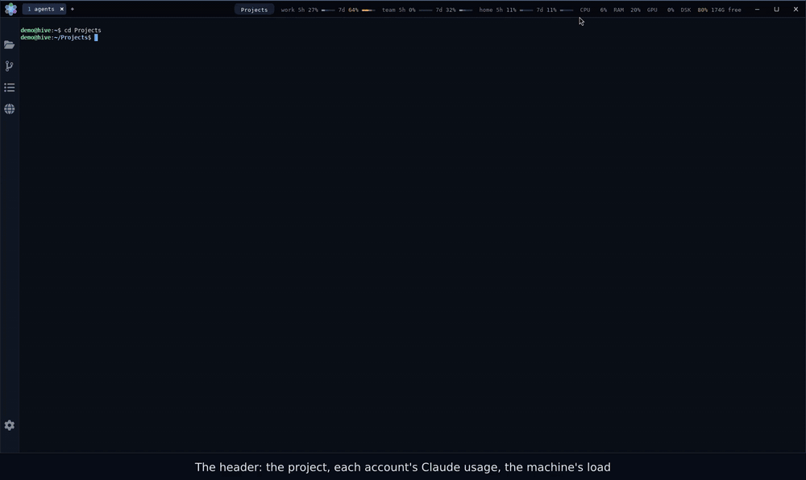
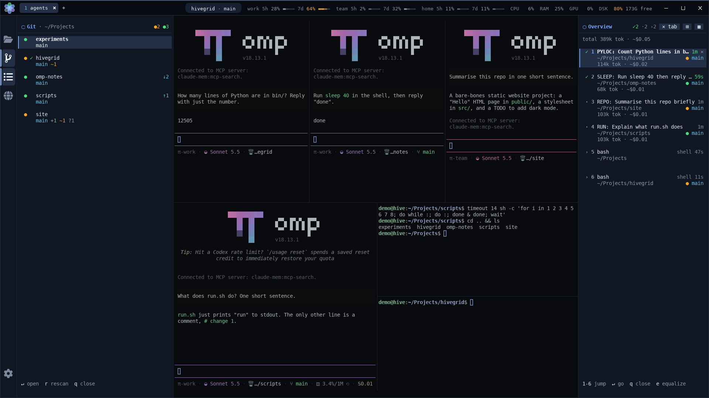
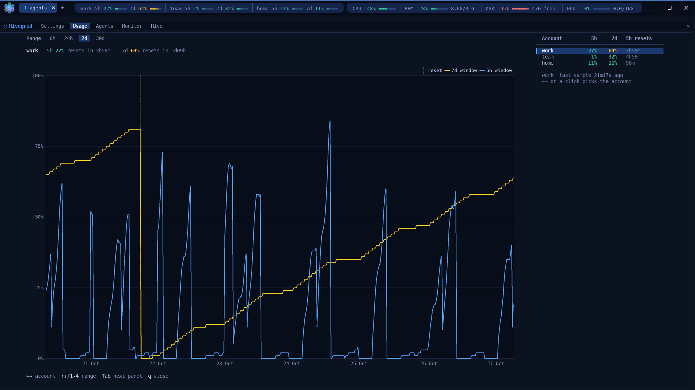
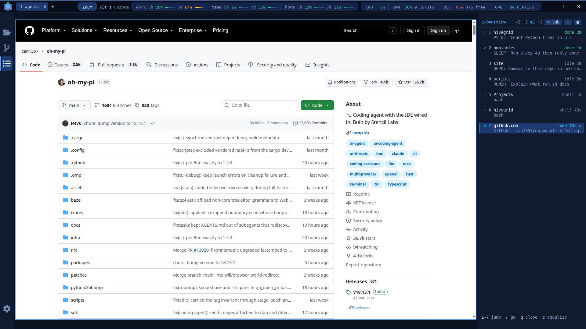
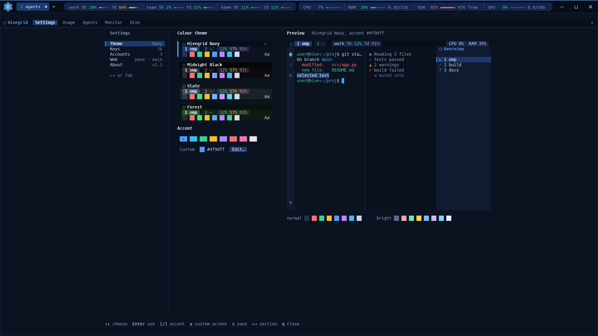

<p align="center"></p>

# Hivegrid

<p align="center">
  <a href="https://github.com/leongreiner/hivegrid/actions/workflows/ci.yml"></a>
  
  <a href="https://github.com/leongreiner/hivegrid/releases"></a>
  <a href="LICENSE"></a>
  
  <a href="https://wezterm.org"></a>
  <a href="CONTRIBUTING.md"></a>
</p>

> **Alpha software.** Hivegrid works and is used daily, but expect rough edges, changing settings and keys, and bugs. Bug reports and pull requests are very welcome (see [Contributing](#contributing)).

Hivegrid is a workspace for running many [`omp`](https://github.com/can1357/oh-my-pi) AI coding agents side by side. It turns [WezTerm](https://wezterm.org) into a pane grid that shows every agent's state at a glance, and adds usage and system history, a file explorer, a git view with CI results, and a web pane, all inside the same window.

## Demo

<p align="center">
  <a href="assets/demo/hivegrid-demo.mp4"></a>
</p>

<p align="center"><em>Highlights, sped up. <a href="assets/demo/hivegrid-demo.mp4">Watch the full demo (3½ minutes, mp4)</a>.</em></p>

Recorded from real omp sessions in an isolated sandbox window with fixture repositories and fictional accounts ([`dev/demo/`](dev/demo)).

| | |
| --- | --- |
|  |  |
|  |  |
|  | |

## Features

- **Agent grid**: `omp-grid` starts one agent per pane; panes tile themselves, equalize, rotate, swap, zoom, and can all be typed into at once (broadcast).
- **Overview dock**: every pane with its number, state (working, busy, needs you, done, idle, exited), omp title and time; jump by click or digit, close panes safely.
- **Accounts and usage**: Claude Code usage (5 h and 7 d) of every account in the header; switch an account from a running chat without losing it.
- **History panels**: usage history charts, a system monitor (CPU, RAM, disk, GPU) and an agent hive of hex cells, plus settings with themes, key bindings and accounts.
- **Left bar**: a yazi file explorer (open a terminal or editor from it) and a git view of every repository with branch, changes, ahead and behind, GitHub Actions results and lazygit.
- **Web pane**: a page of a headless Chrome as a pane of the grid, next to the agents (Hivegrid WezTerm build).
- **Polish**: hover feedback, one themed picker for every list, header pills for the active mode, four colour themes.

[docs/features.md](docs/features.md) describes each in detail.

## Install

Requires Linux with WezTerm 20240203 or newer, Python 3, curl and unzip. The optional web pane also needs the Hivegrid WezTerm build ([below](#custom-wezterm-build)) and Google Chrome or Chromium.

```sh
git clone --recurse-submodules https://github.com/leongreiner/hivegrid.git
cd hivegrid
./install.sh [--tools]     # --tools also downloads yazi, ya and lazygit into ~/.local/bin
```

The installer copies the WezTerm config to `~/.config/wezterm/`, the programs in `bin/` to `~/.local/bin/`, the omp extension that reports agent states, the icon and a `Hivegrid` launcher, and downloads the DejaVu Sans Mono Nerd Font. Differing existing files are saved once as `*.bak.<timestamp>`; no sudo is used. Then start Hivegrid from your application menu or run `hivegrid`, and open `LEADER+1` (`LEADER` is `Ctrl+Space`) for a tab with an omp agent.

For the usage chips each account must be logged in once (`omp --profile=<name>` then `/login`, and/or `claude`). What the installer does exactly, fonts, and account setup: [docs/install.md](docs/install.md).

## Keys

`LEADER` is `Ctrl+Space`. The essentials:

| Keys | Action |
| --- | --- |
| `LEADER+1` / `2` / `3` | new tab with one `omp` / a 2x2 grid / a 3x3 grid |
| `Ctrl+Arrow` | split the pane in that direction (the grid re-tiles itself) |
| `Alt+Arrow`, `Alt+h/j/k/l` | focus a pane |
| `Alt+z` | zoom a pane |
| `LEADER+e`, `Ctrl+Shift+E` | equalize all dividers |
| `LEADER+o` | show or hide the overview dock |
| `Alt+n` | jump to the next pane that needs attention |
| `LEADER+g` | agent picker |
| `Ctrl+F` / `Ctrl+G` | file explorer / git view |
| `LEADER+w`, then `n` | new web pane |
| `LEADER+,` / `LEADER+h` / `LEADER+a` | settings / usage history / agent hive |
| `LEADER+u`, then `1`-`9` | start or switch omp with that account |
| `LEADER+b` | broadcast typing to all panes of the tab |

Every key, with the pane, resize, sidebar, web and panel groups: [docs/keys.md](docs/keys.md). Most of them can be rebound in the settings panel (Keys).

## Panels

`bin/hivegrid-panel [settings|usage|agents|monitor|hive]` is a terminal UI with mouse support: click the tabs, buttons and rows, or use the keys shown at the bottom (`F1`-`F5` and `Tab` switch panels, `q` or `Esc` closes; in the hive `Tab` selects agents, so use the F-keys or click the tabs). On the Hivegrid build it opens as an overlay over the active tab (the panes keep running underneath and come back when it closes); on stock WezTerm it opens in a new tab. From about 170 columns (a 1920 px window) the panels use a wide layout: settings in two panes, usage with an account table beside the chart, and the agents table and monitor graphs centred with a capped width; narrower windows keep one column.

| Open it with | Panel |
| --- | --- |
| the gear button of the left bar, `LEADER+,`, `+` menu `Hivegrid settings` | settings |
| right-click an account pill, `LEADER+h`, `+` menu `Usage history` | usage |
| `+` menu `Agent overview` | agents |
| click the header logo, `LEADER+a`, `+` menu `Agent hive` | hive |
| click the system group (CPU, RAM, DSK, GPU), `+` menu `System monitor` | monitor |

What each panel does: [docs/panels.md](docs/panels.md).

## Grid launcher

`omp-grid` runs inside a WezTerm pane (or anywhere with `--tab`) and starts one command, default `omp`, per pane.

```sh
omp-grid 2 3 ~/work                        # 2 rows x 3 columns in ~/work
omp-grid --layout main-side 3 --name-panes # one main pane, three stacked on the right
omp-grid --layout columns 4 --tab --dirs ~/a,~/b  # new tab, 4 columns, directories cycled
```

`--cmd CMD` swaps the command, `--dir DIR` sets the directory (relative directories are resolved where `omp-grid` runs, and every pane starts in its own one, in reading order); `omp-grid --help` lists everything.

## Accounts and usage

The header shows the Claude Code usage (5 h and 7 d windows) of every account; `claude-quota` fetches and caches it, never storing or logging tokens. Clicking an account pill (or `Alt+q`, or `LEADER+u <n>`) starts omp with that account, or moves the omp that runs in the pane to it with the same chat (`omp-switch`). Accounts are discovered from `~/.claude` and `~/.claude-<name>` and managed in the settings panel. How the numbers are read, the account precedence and the five steps of a chat move: [docs/accounts-and-quota.md](docs/accounts-and-quota.md).

## Custom WezTerm build

`wezterm/` is a submodule pointing at the [WezTerm fork](https://github.com/leongreiner/wezterm) (branch `hivegrid`). It adds clickable header segments, an overlay action for the panels, the drawn header mark, hover for unfocused panes, full-height sidebar panes and the web pane. The config also runs on stock WezTerm 20240203 with reduced features: clicks are ignored, the panels open in a new tab, the bar and dock stay plain, and there is no web pane. To build the fork without sudo, run `git submodule update --init` and then `wezterm/build-hivegrid.sh`. Details: [docs/wezterm-build.md](docs/wezterm-build.md) and `wezterm/HIVEGRID.md`.

## More documentation

| | |
| --- | --- |
| [docs/install.md](docs/install.md) | what the installer does, fonts, account login |
| [docs/keys.md](docs/keys.md) | every key binding |
| [docs/accounts-and-quota.md](docs/accounts-and-quota.md) | how usage is read, account precedence, moving a chat between accounts |
| [docs/features.md](docs/features.md) | every feature in detail |
| [docs/panels.md](docs/panels.md) | settings, usage, agents, monitor and hive panels |
| [docs/wezterm-build.md](docs/wezterm-build.md) | what the WezTerm fork adds and how it degrades on stock WezTerm |
| [docs/notes-and-limits.md](docs/notes-and-limits.md) | known limits, how sidebar views pick their directory, clipboard behaviour |
| [CONTRIBUTING.md](CONTRIBUTING.md) | checks, the QA sandbox, pull requests |
| [AGENTS.md](AGENTS.md) | repository guide for AI coding agents |

## Development

`dev/check` runs every check CI runs (Python, Lua, luacheck, bun, shellcheck, actionlint); `dev/check py lua` runs only some steps. CI (`.github/workflows/ci.yml`) runs one job per group of steps on pushes and pull requests to `main`, checks out without submodules and fails on a missing tool.

`dev/qa/hgq` runs an isolated Hivegrid (the fork build and this repo's `config/` and `bin/`) on its own Xvfb display for manual QA, screenshots and synthetic input (`dev/qa/hgq help`). `dev/smoke` (slot 11) opens the bar's views and the overview dock and checks the panes; `dev/qa/web-smoke` (slot 12; needs Chrome and a fork build with the web pane) drives the web pane end to end. Both are local only.

`dev/demo/record.py` records the demo video and the stills above: `dev/demo/prepare.sh` sets up QA slot 20 with fixture repositories, fictional accounts and usage and omp profiles of their own, then the script drives the window with synthetic input and records the display with ffmpeg. It runs real omp sessions with a few trivial prompts, so it needs a logged-in omp (`DEMO_OMP_SRC`: `~/.omp`, the default profile, or `~/.omp/profiles/NAME`) and Chrome, and uses a few percent of that account's quota.

## Contributing

Hivegrid is open to pull requests: bug fixes, new features, themes, docs and tests. Small focused changes are merged fastest; for a bigger feature or a redesign, open an issue first so the direction can be agreed. [CONTRIBUTING.md](CONTRIBUTING.md) explains how to run the checks (`dev/check`) and how to try a change in an isolated sandbox window (`dev/qa/hgq`). Found a bug or have an idea? Use the [issue templates](https://github.com/leongreiner/hivegrid/issues/new/choose). Security problems go through [SECURITY.md](SECURITY.md); everyone is expected to follow the [code of conduct](CODE_OF_CONDUCT.md).

## License

MIT
