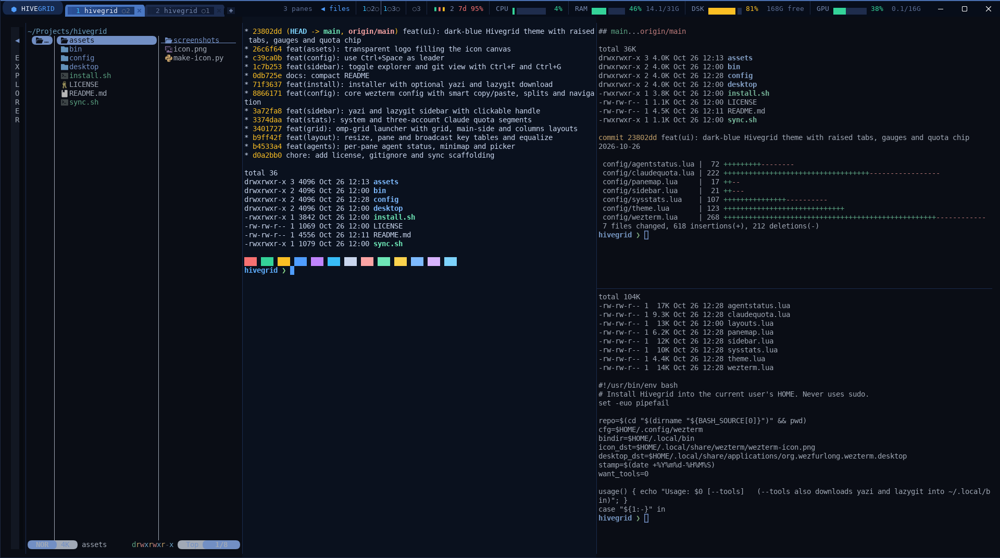
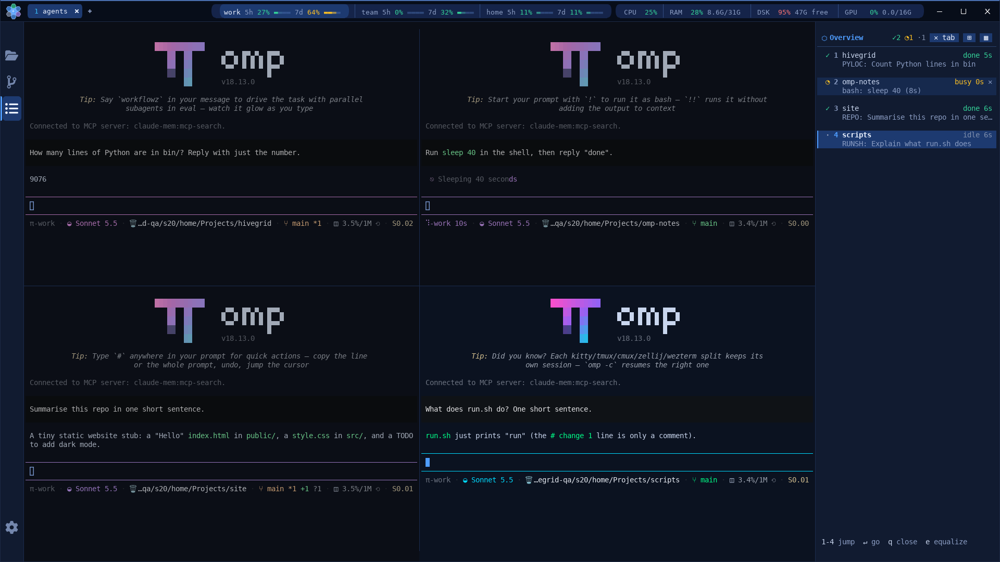

<p align="center"></p>

# Hivegrid

A WezTerm workspace for running many [`omp`](https://github.com/can1357/oh-my-pi) AI coding agents side by side in a pane grid, with per-agent state visible at a glance.





## Features

- Agent state per pane (working, waiting, ask, finished, exited) in tab titles and the header status, plus bell toasts for background panes.
- Pane minimap in the header with agent numbers, and a pane picker (`LEADER+g`) listing every agent with its state and directory.
- `omp-grid` launcher: equal grids, main-plus-side and column layouts, per-pane directories, optional new tab.
- Resize, pane and broadcast key tables, and an equalize command that evens out all dividers.
- Broadcast mode that types into every pane of the tab, with a visible `BROADCAST` marker.
- System stats in the header: CPU, RAM, disk, GPU, each with its percentage, a slim bar and, when the window is wide enough, the absolute amount (`11.7G/31G`, `165G free`).
- Claude Code usage (5h and 7d windows) for every account as a header chip with numbers and slim bars (an account that needs a login shows only an amber `login` chip); accounts are discovered, so a new one appears on its own. Clicking an account starts omp with it, or moves the omp already running in that pane to it with the same chat.
- Panels inside the window (logo click, `LEADER+,`, `+` menu): settings (themes, key bindings, accounts), usage history charts, agent overview and a system monitor.
- Left sidebar with a yazi file explorer or lazygit, toggled by key or by clicking its handle.
- Smart `Ctrl+C` (copy with a selection, interrupt otherwise), `Ctrl+V` paste, `Ctrl+Arrow` splits, `Alt+Arrow` focus.
- Dark-blue theme with rounded tabs level with the header pills, the app icon's honeycomb of seven hexagons drawn at the left of the header (a click opens the settings panel), wide padding, and dimmed inactive panes.

## Install

Requires WezTerm 20240203 or newer, Python 3 and curl.

```sh
git clone git@github.com:leongreiner/hivegrid.git
cd hivegrid
./install.sh [--tools]
```

The installer copies `config/*.lua` to `~/.config/wezterm/`, `config/yazi/` to `~/.config/hivegrid/yazi/` (the explorer's own yazi config; a global `~/.config/yazi` is never read or changed), `bin/` to `~/.local/bin/`, the icon, and a `Hivegrid` launcher that overrides the `org.wezfurlong.wezterm` desktop entry. Differing existing files are saved once as `*.bak.<timestamp>`. `--tools` also downloads the latest `yazi`, `ya` and `lazygit` into `~/.local/bin`. No sudo is used. `./sync.sh` copies the live setup back into the repo for maintenance.

## Keys

`LEADER` is `Ctrl+Space`.

| Group | Keys | Action |
| --- | --- | --- |
| Panes | `Ctrl+Shift+\|` / `Ctrl+Shift+_` | split right / down |
| | `Ctrl+Arrow` | split in that direction |
| | `Alt+Arrow`, `Alt+h/j/k/l` | focus pane |
| | `Alt+z` | zoom pane |
| | `LEADER+r` | resize mode (arrows or `h/j/k/l`, `Esc`/`Enter` leaves) |
| | `LEADER+p` | pane mode: `r`/`R` rotate, `g` select, `s`/`S` swap, `x` close, `t` to new tab, `z` zoom, `e` equalize, `Esc`/`q` leaves |
| Grid | `LEADER+e` | equalize panes |
| | `LEADER+1` / `2` / `3` | new tab with `omp` / 2x2 grid / 3x3 grid (also in the `+` right-click menu) |
| Agents | `Alt+n`, `LEADER+n` | jump to the next pane needing attention |
| | `Alt+]`, `Alt+[` | next / previous agent pane |
| | `LEADER+g` | pane picker |
| | `LEADER+b` | toggle broadcast typing to all panes of the tab |
| Sidebar | `Ctrl+F` / `Ctrl+G` | file explorer / git view |
| | `LEADER+Tab` | hide or show, remembering the view |
| | `Ctrl+C` in the explorer | copy the absolute path of the hovered file or folder, or of all selected entries one per line |
| | double click in the explorer | open a terminal in that folder (a file's folder), split right of the last active grid pane, or below it when that pane is narrow; it takes focus |
| Panels | `LEADER+,` | settings panel |
| | `LEADER+h` | usage history panel |
| | `LEADER+u`, then `1`-`9` | start (or switch) omp with that account |
| Misc | `Ctrl+C` / `Ctrl+V` | smart copy or interrupt / paste |
| | `Alt+s` | toggle system stats |
| | `Alt+q` | Claude quota selector with all accounts; `LEADER+q` hides or shows the header chip |
| | `Ctrl+Shift+R` | reload config |

Leader, sidebar toggles, splits, the account launcher and the panel keys can be rebound in the settings panel (Keys); everything else is fixed.

## Panels

`bin/hivegrid-panel [settings|usage|agents|monitor]` is a terminal UI with mouse support: click the tabs, buttons and rows, or use the keys shown at the bottom (`Tab` and `F1`-`F4` switch panels, `q` or `Esc` closes). On the Hivegrid build it opens as an overlay over the active tab (the panes keep running underneath and come back when it closes); on stock WezTerm it opens in a new tab.

| Open it with | Panel |
| --- | --- |
| click the logo at the top left, `LEADER+,`, `+` menu `Hivegrid settings` | settings |
| right-click an account pill, `LEADER+h`, `+` menu `Usage history` | usage |
| right-click the agents pill (path, pane count, minimap), `+` menu `Agent overview` | agents |
| click the system group (CPU, RAM, DSK, GPU), `+` menu `System monitor` | monitor |

- **Settings** writes `~/.config/hivegrid/settings.json`; the WezTerm config watches it, so *Save* applies at once (a missing file means today's defaults).
  - *Theme*: Hivegrid Navy (the default), Midnight Black, Slate and Forest, with colour swatches, a live preview and an accent colour (quick swatches or any `#rrggbb`). A preset sets the header and tab palette and the terminal colours.
  - *Keys*: click a binding (or `Enter`) and press the new keys. Conflicts with another setting, with the fixed Hivegrid bindings and with WezTerm defaults (`wezterm --skip-config show-keys`) are shown inline; the first two refuse, the last asks. While recording, the config's own bindings are suspended (user var `hivegrid_capture`), so bound chords such as `Ctrl+F` reach the panel. A terminal reports only Ctrl+letter, Alt+key and plain keys; other chords (`CTRL+SHIFT+k`) are typed with *Type it*. *Reset* restores a default.
  - *Accounts*: add, rename, pick the omp profile, hide or remove, rescan. Every `~/.claude` and `~/.claude-<name>` directory that contains a `.credentials.json` is an account (existence only; the file is never read), labelled `main` for `~/.claude` and `<name>` otherwise. omp profiles pair by convention: `main` with `work`, `2` with `team`, `private` with `private`; any other label pairs with `~/.omp/profiles/<label>` when it exists, and otherwise the panel asks for a profile. Entries carry `auto: true/false`, so manual ones survive rescans; removing an entry whose directory still holds credentials hides it instead. A directory the list does not mention yet is shown in the header anyway and offered under *Found on this machine*. Hidden or removed accounts leave the header, the quota refresh and the `LEADER+u` keys at once.
  - *About*: WezTerm version and whether the Hivegrid build (clickable segments, overlay action) is running.
- **Usage** charts the 5h and 7d utilisation of the chosen account over 6 h, 24 h, 7 d or 30 d with window-reset markers, from `~/.cache/wezterm-claude-quota/history.jsonl`, which `claude-quota refresh` appends to (percentages and reset times only, at most one sample per account every two minutes, trimmed to about 30 days, mode 0600). It says when the history starts later than the range.
- **Agents** lists the panes of the window (`wezterm cli list`, the multiplexer of the terminal it runs in): process, omp profile, how long the foreground process has run, directory and title. A click or `Enter` jumps to the pane and closes the panel.
- **Monitor** graphs CPU, RAM, disk and GPU (`nvidia-smi` or Jetson `gpu.0/load`) sampled every second while the panel is open, over 1, 5 or 15 minutes.

Charts are drawn with PIL as inline images (the iTerm2 image protocol, which WezTerm speaks) when `python3-pil` is installed and the terminal is WezTerm; otherwise, or with `HIVEGRID_NO_IMAGES=1`, they are braille plots. The panels need only Python 3.

## Grid launcher

`omp-grid` runs inside a WezTerm pane (or anywhere with `--tab`) and starts one command, default `omp`, per pane.

```sh
omp-grid 2 3 ~/work                        # 2 rows x 3 columns in ~/work
omp-grid --layout main-side 3 --name-panes # one main pane, three stacked on the right
omp-grid --layout columns 4 --tab --dirs ~/a,~/b  # new tab, 4 columns, directories cycled
```

`--cmd CMD` swaps the command, `--dir DIR` sets the directory; `omp-grid --help` lists everything.

## Claude quota

`claude-quota` fetches Claude Code usage for each account and caches only the percentages and reset times in `~/.cache/wezterm-claude-quota/` (plus `history.jsonl`, see Panels). The header reads that cache; the network is never touched from the GUI thread. It reads the OAuth token in-process from the `.credentials.json` of each account directory, calls the usage endpoint with caching and backoff, and never stores or logs tokens. An expired token shows as `login` and is not refreshed. Run `claude-quota refresh` or `claude-quota show` by hand to check it.

The accounts are, in order of precedence: `CLAUDE_QUOTA_DIRS` (or `--dirs`), a comma-separated list; the list in `~/.config/hivegrid/settings.json` (hidden entries skipped) plus every `~/.claude-*` directory holding a `.credentials.json` that the list does not mention; or, without a settings file, those discovered directories alone.

### Switching accounts without losing the chat

Clicking an account pill (or `Alt+q`, or `LEADER+u <n>`) in a pane that runs a shell starts `omp --profile=<profile>`. In a pane that already runs omp under another profile it moves the chat over:

1. `omp-switch locate` finds the session (omp records each terminal's session in `<profile>/agent/terminal-sessions/pts-N`; only paths are read, never the conversation);
2. omp is asked to quit with `Ctrl+D` and has five seconds; with unsent text in its prompt it stays, the switch is abandoned and a toast says so (never `kill`);
3. `omp-switch transfer` copies the finished session file, its artifact directory and the blobs it references into the other profile under the same names, without overwriting anything (a copy of an older part of the same chat is brought up to date; a different chat under that name aborts) and without touching the first profile's files;
4. `omp --profile=<new> --resume '<copy>'` continues the same chat (a fresh `omp --profile=<new>` when no message was written yet; a `cd` first when the shell is not where omp ran).

If the pane looks busy (agent working or asking), a dialog asks "switch anyway?" first, default No; Yes sends `Esc` (omp's interrupt) before quitting.

## Custom WezTerm build

`wezterm/` is a submodule pointing at a private WezTerm fork (branch `hivegrid`) that adds clickable header segments (`status-click`), the `ShowOverlayCommand` key assignment, which runs a program in an overlay over the active tab until it exits (the panels), and the drawn header mark. The mark is the option `tab_bar_brand = { enabled, size, margin_left, margin_right, colors = { center, center_outline, glow, ring, ring_outline } }` (`theme.BRAND_MARK` in `config/theme.lua` sets the icon's colours; the centre cell is blue and the six outer cells show agent-state colours), and `tab_bar_floating_tabs` puts tabs and `+` on the pills' line. The config also runs on stock WezTerm 20240203: clicks are ignored, the panels open in a new tab, the header shows a row of `⬢` glyphs instead of the drawn mark and the tabs rise from the bar's lower edge. To build it without sudo, run `git submodule update --init` and then `wezterm/build-hivegrid.sh`; `wezterm/HIVEGRID.md` has the details.

## Notes and limits

- State is shown through tab titles, the right status and the minimap; on stock WezTerm the header is not clickable.
- The overlay covers the whole active tab; there is no centred modal mode.
- Moving an omp chat to another account needs omp's per-terminal session record (omp 18); with several omp processes in one terminal it refuses rather than guess. The busy check uses the same heuristic as the agent states.
- omp state detection is heuristic: it combines the foreground process, screen text markers, the bell and screen activity.
- The sidebar takes the full window height only in a single-pane tab; in a grid it is docked beside the leftmost pane.
- The sidebar views start in the working directory of the pane they were opened from (the git view in its repository root). A pane whose shell reports a path from another host, such as an ssh session, uses the directory of its local foreground process instead.
- The explorer copies paths with the terminal clipboard escape (OSC 52), which WezTerm accepts, and also through `wl-copy`, `xclip` or `xsel` when present.
- `Ctrl+V` paste is not fanned out in broadcast mode, because the clipboard is not readable from Lua.

## License

MIT
